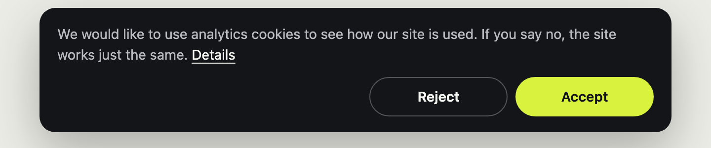

# kvkk-gdpr-consent

[](https://github.com/irodevltd/kvkk-gdpr-consent/actions/workflows/tests.yml)


[English](README.md) · **Türkçe**

Google Analytics (ve diğer analitik betikler) için **KVKK** ve **UK/AB GDPR** kurallarıyla uyumlu kurgulanmış küçük
bir çerez bandı. Bağımlılığı yoktur, onaydan önce hiçbir izleme yapmaz ve sıkı bir İçerik Güvenliği Politikasıyla
(CSP) çalışır.

- **"Kabul et"ten önce hiçbir şey yüklenmez.** Ne Google'ın betiği ne de işaretlediğiniz betikler. "Reddet" aynı
  boyutta bir düğmedir; basması da aynı kolaylıktadır.
- **Tercih her zaman değiştirilebilir.** `data-consent-open` özelliği olan herhangi bir öğe bandı yeniden açar. Onay
  geri alınırsa `_ga` çerezleri silinir ve sayfa yenilenir.
- **Türkçe ve İngilizce hazır gelir.** `<html lang>` değerine uyar; her metni değiştirebilirsiniz.
- **Erişilebilir:** Etiketli bir bölge ve gerçek düğmeler kullanır. Ziyaretçi bandı yeniden açtığında odak banda geçer.

[irodev.net](https://irodev.net) üzerinde çalışan bandın bağımsız hâlidir.



## Kullanım

```html
<link rel="stylesheet" href="consent.css">
<script src="consent.js" data-ga="G-XXXXXXXXXX" data-privacy="/gizlilik#cerezler" defer></script>

<!-- herhangi bir yerde, örneğin alt bilgide -->
<button type="button" data-consent-open>Çerez tercihleri</button>
```

Bu kadar: İlk ziyarette bant görünür; "Kabul et"ten sonra Google Analytics 4 ölçüm kimliğinizle yüklenir.

Betik klasik bir betik olmalıdır (`type="module"` değil): Seçeneklerini kendi etiketinden okur.

### Diğer betikleri bekletmek

Herhangi bir betiği `type="text/plain"` ve `data-consent="analytics"` ile işaretleyin. Tarayıcı ziyaretçi kabul
edene kadar onu yok sayar; ardından normal bir betik olarak çalışır:

```html
<script type="text/plain" data-consent="analytics" src="https://ornek.com/isi-haritasi.js"></script>
<script type="text/plain" data-consent="analytics">
  analitigiBaslat();
</script>
```

### Seçenekler

| Özellik | Varsayılan | |
| --- | --- | --- |
| `data-ga` | yok | GA4 ölçüm kimliğiniz (`G-…`). Verilmezse "Kabul et"ten sonra yalnızca işaretli betikler çalışır. |
| `data-privacy` | yok | Gizlilik bildiriminizin çerez bölümünün bağlantısı ("Ayrıntılar"). |
| `data-lang` | `<html lang>` | `tr` ya da `en`. |
| `data-text` | hazır metin | Banttaki cümle. |
| `data-accept-label`, `data-reject-label`, `data-more-label` | hazır metin | Düğme ve bağlantı metinleri. |
| `data-label` | hazır metin | Bölgenin erişilebilir adı. |
| `data-accept-class`, `data-reject-class` | yok | Sitenizin düğme stillerini kullanmak için ek sınıflar. |
| `data-storage-key` | `consent` | Tercihin (`yes` ya da `no`) tutulduğu localStorage anahtarı. |
| `data-cookies` | `_ga` | Onay geri alınınca silinecek çerez adı önekleri, virgülle ayrılmış. |

### JavaScript

```js
KvkkConsent.choice();   // 'yes', 'no' ya da null
KvkkConsent.open();     // bandı yeniden göster
KvkkConsent.reset();    // tercihi unut ve yeniden sor

document.addEventListener('consentchange', function (e) {
  if (e.detail.analytics) { /* ziyaretçi kabul etti */ }
  else { e.preventDefault(); /* onay geri alındı: sayfa yenilemek yerine kendiniz ele alın */ }
});
```

### Görünüm

`.consent-banner` üzerindeki değişkenleri değiştirin: `--consent-bg`, `--consent-fg`, `--consent-muted`,
`--consent-accept-bg`, `--consent-accept-fg`, `--consent-reject-bg`, `--consent-reject-fg`, `--consent-border`,
`--consent-radius`, `--consent-font`. İki düğmeyi eşit derecede görünür tutun.

### İçerik Güvenliği Politikası (CSP)

Bant satır içi betik ya da stil eklemez. `data-ga` kullanıyorsanız Google'ın adreslerine izin verin:

```
script-src  'self' https://www.googletagmanager.com;
connect-src 'self' https://*.google-analytics.com https://*.analytics.google.com https://*.googletagmanager.com;
img-src     'self' https://*.google-analytics.com https://*.googletagmanager.com;
```

### CDN'den

v1.0.0 sürümü yayınlandıktan sonra jsDelivr dosyaları doğrudan bu depodan sunar (anında küçültür):

```html
<link rel="stylesheet" href="https://cdn.jsdelivr.net/gh/irodevltd/kvkk-gdpr-consent@1.0.0/src/consent.min.css">
<script src="https://cdn.jsdelivr.net/gh/irodevltd/kvkk-gdpr-consent@1.0.0/src/consent.min.js" data-ga="G-XXXXXXXXXX" defer></script>
```

CDN, ziyaretçilerinizin tarayıcısının bağlandığı üçüncü bir taraftır. Gizlilik bildiriminiz üçüncü taraf olmadığını
söylüyorsa dosyaları kendi sunucunuzda barındırın.

## Gizlilik bildiriminiz

Bant onayı yönetir; bunu açıklamak gizlilik bildiriminizin işidir. Google Analytics için bildirim genellikle şunları
anlatır: neyin ölçüldüğü, çerezler (`_ga` ve `_ga_<KİMLİK>`, en fazla 2 yıl saklanır), hizmet sağlayıcınız olarak
Google, verilerin ABD'ye aktarılması ve bunun hukuki dayanağı, verilerin ne kadar saklandığı (Google Analytics'te
saklama süresini ihtiyacınız olan en kısa süreye ayarlayın) ve onayın nasıl geri alınacağı.
[irodev.net gizlilik bildirimi](https://irodev.net/tr/gizlilik) bir örnektir. Bu bir hukuki tavsiye değildir:
bildiriminizi işletmeniz için bir uzmana kontrol ettirin.

## Testler

```bash
npm install
npm test
```

Testler betiği [jsdom](https://github.com/jsdom/jsdom) içinde çalıştırır. [`examples/index.html`](examples/index.html)
Google'a hiç istek göndermeyen bir demodur.

## Lisans

MIT © [İRODEV LTD](https://irodev.net). İrodev; Türkiye ve Birleşik Krallık'taki işletmeler için web siteleri ve
yazılımlar geliştiren bir stüdyodur.
